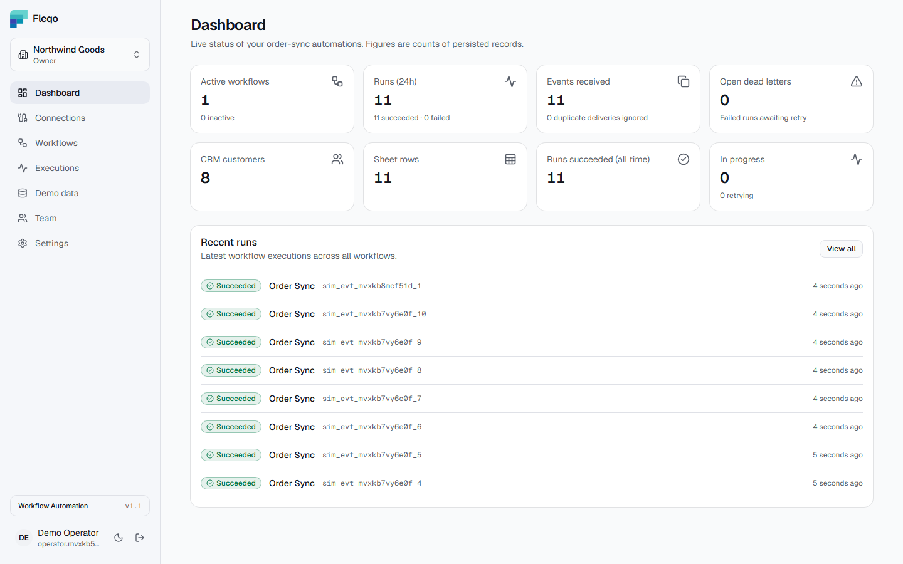
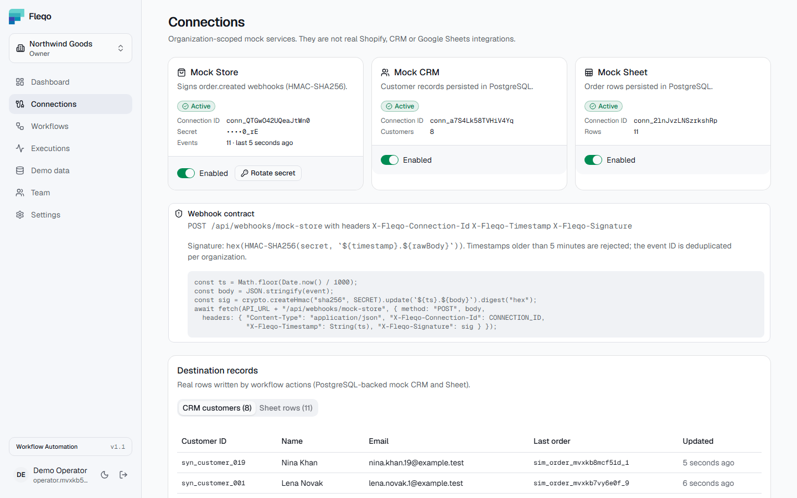
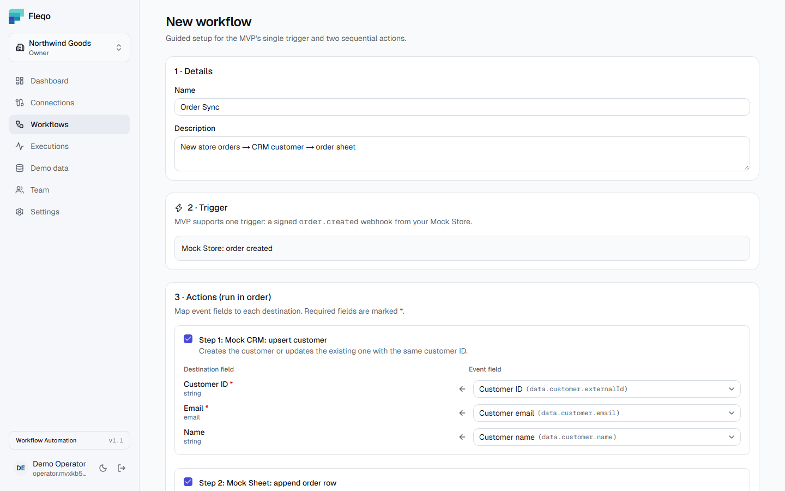
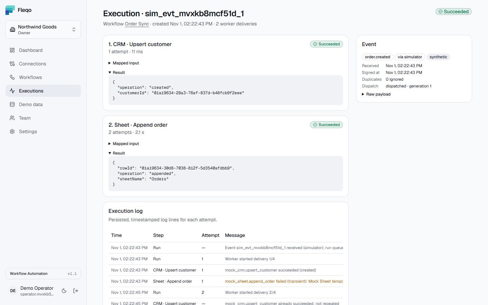
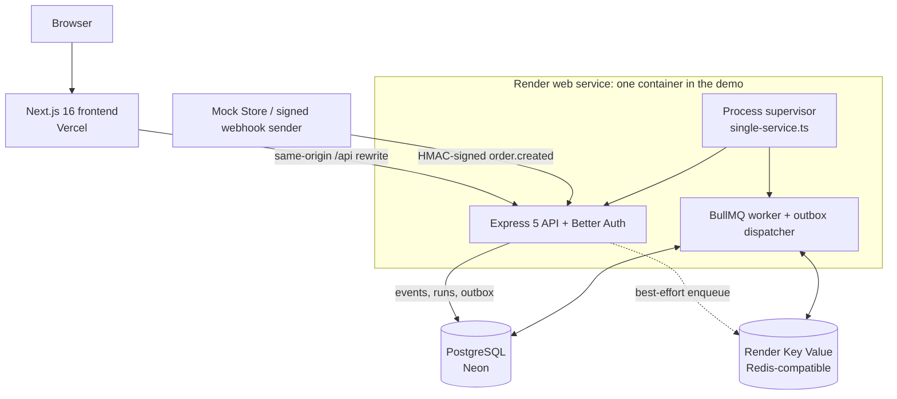

<div align="center">


# Fleqo

### Event-driven workflow automation, with reliability built in.

A **multi-tenant workflow automation platform** that turns signed order webhooks into CRM and spreadsheet updates, **exactly once**, with retries, dead letters, recovery and a full execution trail.

[**Live Demo**](https://fleqo-web.vercel.app/) · [**Interactive Demo**](https://fleqo-web.vercel.app/#demo) · [**Product Docs**](https://fleqo-web.vercel.app/docs) · [**Architecture**](docs/architecture.md) · [**API Specification**](docs/api-spec.yaml)

[](https://github.com/shariardipto/Fleqo/actions/workflows/ci.yml)


</div>

> [!NOTE]
> **Project scope.** Fleqo is a working **portfolio SaaS prototype**, not a general-purpose Zapier replacement. Its Store, CRM and Sheet connectors are **PostgreSQL-backed mock integrations**, not real Shopify, HubSpot or Google Sheets connections. That keeps every side effect real, inspectable and testable without third-party accounts. Sample data is synthetic or imported from the public [DummyJSON](https://dummyjson.com/docs) API, and is labelled as such everywhere.

> [!TIP]
> **Trying the live demo?** The backend runs on free tiers and sleeps after 15 minutes without traffic. The first sign-in after a pause can take **1–2 minutes**; if you see an error, wait a moment and retry. The landing page and the interactive demo load instantly.

## Contents
[Preview](#preview) · [What you can try](#what-you-can-try) · [How it works](#how-it-works) · [Core capabilities](#core-capabilities) · [Reliability guarantees](#reliability-guarantees) · [Technology stack](#technology-stack) · [Architecture](#architecture) · [Security](#security) · [Testing and validation](#testing-and-validation) · [Run locally](#run-locally) · [Deployment](#deployment) · [Documentation](#documentation) · [Project structure](#project-structure) · [Scope and roadmap](#scope-and-roadmap) · [Copyright & Usage](#copyright--usage)

## Preview

**Dashboard: workflow activity, run status and destination counts**

<picture>
  <source media="(prefers-color-scheme: dark)" srcset="apps/web/public/screens/dashboard-dark.png">
  
</picture>

<details>
<summary><strong>More screenshots</strong>: connections, workflow builder, execution trace</summary>
<br>

<table>
  <tr>
    <td align="center" width="50%">
      <picture>
        <source media="(prefers-color-scheme: dark)" srcset="apps/web/public/screens/connections-dark.png">
        
      </picture>
      <br><sub><b>Connections and mock destinations</b></sub>
    </td>
    <td align="center" width="50%">
      <picture>
        <source media="(prefers-color-scheme: dark)" srcset="apps/web/public/screens/workflows-dark.png">
        
      </picture>
      <br><sub><b>Guided workflow builder</b></sub>
    </td>
  </tr>
  <tr>
    <td align="center" colspan="2">
      <picture>
        <source media="(prefers-color-scheme: dark)" srcset="apps/web/public/screens/executions-dark.png">
        
      </picture>
      <br><sub><b>Execution detail: per-action results, a retried Sheet action and the timestamped log</b></sub>
    </td>
  </tr>
</table>

Screenshots are captured from the real application with synthetic data, and follow your GitHub light or dark theme.

</details>

## What you can try

**Without an account:** open the [interactive demo](https://fleqo-web.vercel.app/#demo). It walks a sample order through HMAC signing and verification, queueing, the CRM and Sheet actions and the log. It can also re-send the event to show duplicate detection, and simulate a CRM outage whose retry does not repeat completed work. It runs **entirely in your browser** and writes nothing to the server.

**With an account** (free, email and password):
1. Create an organization. You become its **Owner**.
2. **Connections:** enable the Mock Store, Mock CRM and Mock Sheet. The store's signing secret is shown once.
3. **Workflows → New:** build *Order Sync* (`order.created` → upsert customer → append order) and review the field mapping.
4. **Demo data:** import DummyJSON or synthetic records, then send signed events, optionally with injected failures or a duplicate re-send.
5. **Executions:** watch runs complete live, open one to see each action's input, output, attempts and log, and retry failed runs.
6. **Team:** invite a teammate with an invite link and a role.

## How it works

```text
Mock Store                      Fleqo API                                   Mock destinations
order.created ──HMAC-signed──▶ verify ─▶ one DB transaction ─▶ BullMQ ─▶ Worker ─┬─▶ CRM: upsert customer
   webhook                      (raw body,  (event + runs +       (Redis)          └─▶ Sheet: append order row
                                 replay,     outbox row)
                                 schema)          │
                                                  └── PostgreSQL: events, runs, action state, logs, audit trail
```

1. **Verify.** The API reads the raw request bytes, resolves the connection from `X-Fleqo-Connection-Id`, rejects timestamps outside ±5 minutes, and compares an HMAC-SHA256 of `<timestamp>.<body>` in constant time. Only then does it parse and validate the JSON.
2. **Persist.** One transaction stores the event, a run for each matching workflow, its actions and an outbox row; the API answers `202` only after the commit. A re-delivered event gets `200 duplicate`; the same event ID with a different payload gets `409`.
3. **Dispatch.** The run is enqueued at once. If Redis is unavailable, the outbox row stays pending and the worker's dispatcher (`FOR UPDATE SKIP LOCKED`) enqueues it later.
4. **Execute.** The worker leases the run, skips actions that already succeeded, and commits each destination write **in the same transaction** as that action's success.
5. **Recover.** Transient errors retry with exponential backoff. Permanent or exhausted ones become dead letters that an Admin can retry. A recovery sweep re-dispatches runs whose queue jobs were lost.

## Core capabilities

| Area | What is implemented |
| --- | --- |
| **Workflow automation** | Guided `order.created` → customer upsert → order append workflow, with type-checked field mapping and enable, disable and archive controls |
| **Secure webhooks** | Raw-body HMAC-SHA256, replay window, 64 KB limit, Zod schema validation, per-IP rate limit, tenant resolved only from the verified connection |
| **Reliable execution** | Transactional outbox, BullMQ worker, run leases, exponential-backoff retries, stale-run recovery, dead letters, manual retry of incomplete actions |
| **Idempotency** | Unique keys at the event, run, action and destination levels; duplicates create no runs, and retries never repeat completed actions |
| **Multi-tenancy** | Organizations with Owner, Admin and Member roles; membership re-checked on every request; invite links; audit log |
| **Operations UI** | Dashboard, connections with destination records, workflow builder, demo importer and simulator, live execution history with per-action inputs, outputs, errors and logs |
| **Identity** | Better Auth email/password sessions; optional email verification and password reset (Resend); optional Google, GitHub, Apple and X sign-in |
| **Experience** | Responsive layout, Light/Dark/System themes without flash, WCAG AA checked with axe in both themes, public landing page and product docs |

## Reliability guarantees

What happens when things go wrong, each covered by an automated test:

| Situation | Outcome |
| --- | --- |
| The same event is delivered again (even with JSON keys reordered) | Acknowledged as `duplicate`; no new run |
| Same event ID, different payload | Rejected with `409` |
| Forged signature, altered body or stale timestamp | Rejected with `401`; nothing stored |
| Redis is down when an event arrives | Event still accepted; the outbox dispatches it once Redis is back |
| Worker killed in the middle of a run | Run recovered after restart; completed actions are **not** repeated |
| Queue data lost (Redis restart without persistence) | Recovery sweep re-dispatches unfinished runs from PostgreSQL |
| Transient destination error | Retried with exponential backoff (4 attempts by default) |
| Permanent error or retries exhausted | Dead-letter record; an Admin or Owner can retry only the failed actions |

PostgreSQL is the source of truth; Redis only transports jobs. Correctness never depends on queue job IDs.

## Technology stack

| Layer | Technology |
| --- | --- |
| Frontend | Next.js 16 (App Router), React 19, TypeScript, Tailwind CSS 4, shadcn/ui, TanStack Query |
| Backend | Node.js, Express 5, TypeScript, Zod, pino |
| Authentication | Better Auth with the Organization plugin |
| Database | PostgreSQL 16+ (18 locally), Prisma 7 with `@prisma/adapter-pg` |
| Async jobs | BullMQ 6 on Redis/Valkey, transactional outbox |
| Testing | Vitest, Supertest, Playwright, axe-core |
| Infrastructure | Docker, Docker Compose, GitHub Actions |
| Hosting | Vercel, Render, Neon |

## Architecture

The **live demo** runs the API and the BullMQ worker as two supervised child processes inside **one Render Free web service**. The same Docker image also deploys them as **separate services** for production.



- **Same-origin proxy:** browsers talk only to the Vercel origin, which rewrites `/api/*` to the API, so session cookies stay first-party and CORS stays strict.
- **Tenant isolation:** the tenant is the session's active organization, never a request parameter, and every query is scoped by resource ID **and** organization.
- **Mock destinations in PostgreSQL:** CRM and Sheet writes share a transaction with the action's state, which is what makes exactly-once observable and testable.

More: [architecture](docs/architecture.md) · [database ERD](docs/database-erd.md) · [API contract](docs/api-spec.yaml)

## Security

- **Authorization:** membership and role are verified server-side on every protected request. Cross-tenant access returns `404`. Members are read-only plus the simulator.
- **Webhooks:** raw-body HMAC-SHA256 with constant-time comparison, ±300 s replay window, size limit, schema validation and per-IP rate limiting.
- **Secrets:** connection signing secrets are AES-256-GCM encrypted at rest and shown once. Logs redact cookies, authorization and signature headers. Secrets never reach the browser.
- **Sessions:** database-backed sessions in HttpOnly, `SameSite=Lax`, `Secure` cookies. CSRF is blocked by a CORS allow-list, Better Auth origin checks and Fleqo's own trusted-origin check on mutations.
- **Headers:** CSP, HSTS, X-Frame-Options and Permissions-Policy on the web; Helmet and `Cache-Control: no-store` on the API.
- **Invitations:** usable only through the invite link by the invited account, never discoverable by email.
- **OAuth (optional):** `state` + PKCE, trusted callback URLs only, and no automatic linking into unverified local accounts.
- **Fail-safe configuration:** the API refuses to start in production with non-HTTPS origins, disabled TLS verification, half-configured OAuth or inconsistent email settings. CI gates on `npm audit`.

Full control mapping (OWASP Top 10) and residual risks: [docs/security.md](docs/security.md).

## Testing and validation

CI runs on every push and pull request: dependency audit, migrations, schema-drift guard, lint, typecheck, API tests, build, browser E2E, smoke test, process-level reliability checks and the Docker image build.

| Suite | Scope | Result |
| --- | --- | --- |
| API integration | 12 files, 74 tests against real PostgreSQL and Redis: tenancy and RBAC, webhook security, idempotency, retries, recovery, auth, email | **74 / 74 passed** |
| 100-event batch | 100 signed events + 25 duplicates + 5 forged + 10 injected transient failures | **100 / 100 runs succeeded**: 30 CRM customers, 100 sheet rows, 215 attempts, 0 dead letters |
| Browser E2E | Production build with CSP: full operator loop, roles, invite links, password reset, themes, landing page, axe WCAG AA in light and dark | **23 passed, 3 skipped** (OAuth specs need provider credentials) |
| Reliability | Compiled API and worker vs. worker kill, Redis and PostgreSQL restarts, API restart | No lost runs, no duplicate rows, completed actions never repeated |
| Smoke | 13 black-box checks against any running environment | **13 / 13 passed** |
| Free-tier emulation | Single container under 0.1 CPU / 512 MB, queue loss, crashes, cold starts | Recovered from every failure ([details](docs/deployment-demo.md#6-measured-results-local-emulation-of-the-free-tiers)) |

These are functional and failure-recovery results, not load tests. Details: [docs/testing.md](docs/testing.md).

## Run locally

**Prerequisites:** Node.js ≥ 22.12, npm, and Docker (Desktop or Engine).

```bash
# 1. Clone and install (add --include=dev if NODE_ENV=production is set in your shell)
git clone https://github.com/shariardipto/Fleqo.git
cd Fleqo
npm install

# 2. Start PostgreSQL and Redis
cp .env.example .env
npm run infra:up

# 3. Configure the API and worker, then paste two generated secrets into apps/api/.env
cp apps/api/.env.example apps/api/.env
node -e "console.log(require('crypto').randomBytes(32).toString('base64'))"   # BETTER_AUTH_SECRET
node -e "console.log(require('crypto').randomBytes(32).toString('base64'))"   # ENCRYPTION_KEY

# 4. Apply migrations (optional: seed a demo account)
npm run db:deploy
SEED_DEMO_PASSWORD='choose-a-password' npm run db:seed

# 5. Start each process in its own terminal
npm run dev:api      # http://localhost:4000
npm run dev:worker   # queue consumer + outbox dispatcher
npm run dev:web      # http://localhost:3000
```

Open **http://localhost:3000**, create an account and follow the dashboard checklist. The web app proxies `/api/*` to the local API, and the Prisma client is generated automatically by `dev`, `typecheck`, `test` and `build`.

### Useful commands

| Command | Purpose |
| --- | --- |
| `npm run lint` / `npm run typecheck` | ESLint and TypeScript for the API and web |
| `npm test` | API tests on a separate `*_test` database (includes the 100-event batch) |
| `npm run test:batch` | Only the 100-event batch; writes `apps/api/test-results/batch-summary.json` |
| `npm run test:e2e` | Playwright browser tests (starts the stack if it isn't running) |
| `npm run test:reliability` | Crash and restart scenarios in throwaway Docker containers |
| `npm run smoke -- --base-url <url>` | Black-box checks against a running environment |
| `npm run build` | Production builds of the API and web |
| `npm run db:migrate` | Create a migration after changing `schema.prisma` |

### Configuration

| Where | Key variables |
| --- | --- |
| `apps/api/.env` (API and worker) | `DATABASE_URL`, `REDIS_URL`, `BETTER_AUTH_URL` (the web origin), `BETTER_AUTH_SECRET`, `WEB_ORIGINS`, `ENCRYPTION_KEY`, plus optional tuning, OAuth and email settings |
| `apps/web` (build time) | `API_URL` (where `/api/*` is proxied), `NEXT_PUBLIC_SITE_URL` (canonical and Open Graph URLs) |

Every variable is documented in [`apps/api/.env.example`](apps/api/.env.example). Production and demo templates are in [`deploy/`](deploy/). Never commit `.env` files or real credentials.

## Deployment

| | Live portfolio demo | Production topology |
| --- | --- | --- |
| Web | [Vercel Hobby](https://fleqo-web.vercel.app/) | Vercel |
| API and worker | One Render Free web service; `node dist/single-service.js` supervises both ([health](https://fleqo.onrender.com/api/health)) | Render Web Service + Render Background Worker, same image |
| PostgreSQL | Neon Free | Render Postgres (paid, with backups) |
| Redis | Render Key Value Free (`noeviction`, not persistent) | Render Key Value (`noeviction`, persistent) |
| Migrations | At start, only when pending | Pre-deploy command `npm run db:deploy` |
| Guide | [docs/deployment-demo.md](docs/deployment-demo.md) | [docs/deployment.md](docs/deployment.md) |

**Free-tier behaviour:** the demo backend spins down after 15 minutes without traffic, and the worker sleeps with it. Queued work resumes when the service wakes, and the first request after a pause can fail or wait while it starts. Free Key Value is not persistent; Fleqo recovers lost jobs from PostgreSQL. This is a low-traffic portfolio demo, not an SLA-backed service.

## Documentation

| Document | Contents |
| --- | --- |
| [architecture.md](docs/architecture.md) | Components, event lifecycle, idempotency layers, request pipeline, design decisions |
| [database-erd.md](docs/database-erd.md) | Entity diagram, constraints and indexes, tenancy rules |
| [api-spec.yaml](docs/api-spec.yaml) | OpenAPI 3.1 contract |
| [security.md](docs/security.md) | Controls mapped to the OWASP Top 10, residual risks |
| [authentication.md](docs/authentication.md) | Sessions, roles, invitations, email verification and reset, OAuth provider setup |
| [frontend.md](docs/frontend.md) | Pages, landing page, theming and design tokens, accessibility |
| [testing.md](docs/testing.md) | Test layers, 100-event batch, E2E coverage, reliability scenarios |
| [deployment.md](docs/deployment.md) | Production deployment, backups, rollback, verification checklist |
| [deployment-demo.md](docs/deployment-demo.md) | $0 demo deployment and measured free-tier results |
| [AGENTS.md](AGENTS.md) | Conventions and safety rules for coding agents |

## Project structure

```text
apps/
  api/                    Express API, BullMQ worker, demo supervisor (src/single-service.ts),
                          Prisma schema and migrations, Vitest suites, production Dockerfile
  web/                    Next.js app, landing page, Playwright specs, screenshots
deploy/
  demo/                   $0 demo environment template
  env/                    Production environment templates (placeholders only)
docs/                     Architecture, data model, API, security, testing, deployment
scripts/                  Process-level reliability check
.github/workflows/ci.yml  Verify, reliability and Docker jobs
compose.yaml              PostgreSQL + Redis for local development
```

## Scope and roadmap

**Included today:** mock Store, CRM and Sheet connections; one trigger (`order.created`) and two sequential actions; synthetic and DummyJSON demo data; signed ingestion with inspectable retries, dead letters and execution history.

**Known limitations:**
- One connection per mock provider per organization.
- Invitations are shared as links; no invitation email is sent.
- Social sign-in and email delivery are implemented and tested offline, but not enabled on the live demo.
- Rate limits are in memory per API instance.
- Execution and audit logs have no retention job yet.

**Not included (possible future work, not shipped):** real Shopify, WooCommerce, HubSpot or Google Sheets integrations; arbitrary triggers and actions; branching or a visual canvas; commercial uptime guarantees.

## Copyright & Usage

Copyright © 2026 Fleqo. All Rights Reserved.

Fleqo is a proprietary software project publicly showcased for portfolio, educational review, and technical evaluation purposes.

The source code is available for viewing and evaluation. No license is granted to copy, modify, redistribute, or commercially use the original project code, except as permitted by applicable law or GitHub's terms of service.

Third-party dependencies remain subject to their respective licenses.

---

<div align="center">

**Fleqo: Workflow Automation v1.1**

[Live demo](https://fleqo-web.vercel.app/) · [Product docs](https://fleqo-web.vercel.app/docs) · [CI](https://github.com/shariardipto/Fleqo/actions/workflows/ci.yml)

</div>
