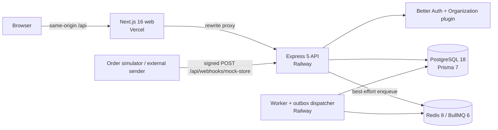

# Fleqo

**Integration & workflow automation for small online stores.** When a new order arrives, Fleqo upserts the customer into a CRM and appends the order to a spreadsheet — with signed webhooks, durable event ingestion, idempotent actions, retries, a dead-letter queue and a full execution log.

> **MVP scope.** The store, CRM and spreadsheet are **PostgreSQL-backed mock integrations**, not real Shopify / CRM / Google Sheets connections. Demo inputs come from the public [DummyJSON](https://dummyjson.com/docs) API or an offline synthetic generator, and every generated order is labelled synthetic. No paid API is required.

> **v1.1 (2026-11-01):** public landing page with an in-browser product demo, `/docs`, redesigned sign-in/sign-up with optional Google, GitHub, Apple and X sign-in (configured per environment; **not live-verified** without provider credentials), and a one-click light/dark theme across the whole app, a theme-matched logo and favicon, and a "Workflow Automation v1.1" release label in the app sidebar. Verified: lint, typecheck, 74 API tests, 26 browser tests (including axe WCAG AA in light and dark and the email password-reset flow); GitHub Actions green. Optional email verification and password reset ([docs/email.md](docs/email.md)) and Railway Infrastructure as Code ([`.railway/railway.ts`](.railway/railway.ts)). See [docs/landing-page.md](docs/landing-page.md), [docs/social-auth.md](docs/social-auth.md) and [docs/theme-architecture.md](docs/theme-architecture.md).
>
> **Release status (v1.0, 2026-11-01): release-ready locally, not deployed.** Everything locally executable is verified (lint, typecheck, 59 API tests, 100-event batch, 5 browser tests, an 8-scenario reliability script, and the production Docker image with smoke tests). Live deployment is waiting for cloud credentials and approval. See [docs/release-audit.md](docs/release-audit.md), [docs/security-audit.md](docs/security-audit.md), [docs/production-test-results.md](docs/production-test-results.md) and [docs/deployment.md](docs/deployment.md).

```
Mock Store ──signed order.created──▶ Express API ──outbox──▶ BullMQ ──▶ Worker ──▶ Mock CRM (upsert customer)
                                        │                                 └────▶ Mock Sheet (append order row)
                                   PostgreSQL (events, runs, action state, logs, destination records)
```

## Contents
- [Features](#features)
- [Architecture](#architecture)
- [Quick start](#quick-start)
- [Testing and real results](#testing-and-real-results)
- [Configuration](#configuration)
- [Deployment](#deployment)
- [Design decisions and trade-offs](#design-decisions-and-trade-offs)
- [Security](#security)
- [Known limitations](#known-limitations)
- [Repository layout](#repository-layout)

## Features
- **Public website** — landing page at `/` (hero, interactive in-browser demo, features, how it works, integrations, real product screenshots, security), plus `/docs`. Signed-in visitors get **Go to Dashboard**.
- **Accounts and organizations** — Better Auth email/password with optional email verification and password reset, plus optional Google / GitHub / Apple / X sign-in (shown only when configured, with safe account linking); organizations with **Owner / Admin / Member** roles (Better Auth Organization plugin). Membership and role are re-checked server-side on every request. Teammates join through **invite links**; invitations are never discoverable by email.
- **Connections** — `mock_store`, `mock_crm`, `mock_sheet` per organization. The store's webhook signing secret is AES-256-GCM encrypted at rest and shown once.
- **Guided workflow builder** — `mock_store.order.created` → `mock_crm.upsert_customer` → `mock_sheet.append_order`, with type-checked field mapping, enable/disable and archive.
- **Signed webhook receiver** — HMAC-SHA256 over the raw body, 5-minute replay window, Zod validation, tenant resolved only from the verified connection.
- **Reliable execution** — transactional outbox, BullMQ worker, run leases, exactly-once commit of each action's side effect, exponential-backoff retries, dead-letter records and authorized manual retry that skips completed actions.
- **Demo data** — DummyJSON import (users, products, carts) with provenance and licence notes, or a deterministic offline generator; an order simulator with fault injection and duplicate re-send.
- **Themes** — Light, Dark and System everywhere (landing, auth, app), persisted per browser, with no flash on load and semantic design tokens that meet WCAG AA in both themes.
- **Operator UI** — dashboard, connections (with destination records), workflows, executions (filters, live refresh, per-action input/output/errors/logs), demo data, team and settings (audit log). Responsive, accessible, with loading / error / empty states.

## Architecture



**Event lifecycle**
1. `POST /api/webhooks/mock-store` reads the **raw bytes** (mounted before `express.json()`), resolves the connection by `X-Fleqo-Connection-Id`, checks `X-Fleqo-Timestamp` (±300 s) and a constant-time HMAC of `<timestamp>.<raw body>`, then validates the JSON.
2. **One transaction** stores the `IncomingEvent` (unique per org + provider + event ID), a `WorkflowRun` per matching active workflow, its queued `ActionRun`s and an `EventDispatch` outbox row. Only then does the API answer `202`. A duplicate returns `200 {"status":"duplicate"}` without new runs; the same event ID with a different payload returns `409`.
3. The API tries to enqueue right away. If Redis is down, the outbox row stays `pending` and the worker's dispatcher (`FOR UPDATE SKIP LOCKED`) enqueues it later.
4. The worker takes a **lease** on the run, skips actions that already succeeded, and commits each destination write **in the same transaction** as a conditional `ActionRun → succeeded` update. Transient errors are retried by BullMQ with exponential backoff; permanent or exhausted failures write a `DeadLetterEvent`.
5. An Admin/Owner can retry a failed run: only incomplete actions run again, and the outbox generation is bumped so a fresh job is enqueued.

More detail: [`docs/architecture.md`](docs/architecture.md), [`docs/database-erd.md`](docs/database-erd.md), [`docs/api-spec.yaml`](docs/api-spec.yaml), [`docs/ui-ux-spec.md`](docs/ui-ux-spec.md).

## Quick start

**Prerequisites:** Node.js ≥ 22.12 (developed on 24.22), npm 11, Docker Desktop.

```bash
# 1. Infrastructure
cp .env.example .env                       # Postgres credentials for compose.yaml
npm run infra:up                           # PostgreSQL 18 + Redis 8, waits for health checks

# 2. Dependencies (--include=dev matters if NODE_ENV=production is set in your shell)
npm install --include=dev

# 3. API configuration
cp apps/api/.env.example apps/api/.env
#   set DATABASE_URL to match .env, and generate the two secrets:
node -e "console.log(require('crypto').randomBytes(32).toString('base64'))"   # BETTER_AUTH_SECRET
node -e "console.log(require('crypto').randomBytes(32).toString('base64'))"   # ENCRYPTION_KEY

# 4. Database
npm run db:deploy                          # apply migrations (use db:migrate while changing the schema)
SEED_DEMO_PASSWORD='choose-a-password' npm run db:seed   # optional: demo@fleqo.local + Demo Store

# 5. Run the three processes (separate terminals)
npm run dev:api        # http://localhost:4000  (Express API)
npm run dev:worker     # BullMQ consumer + outbox dispatcher
npm run dev:web        # http://localhost:3000  (Next.js; proxies /api → :4000)
```

The Prisma client (`apps/api/src/generated`) is not committed: `dev`, `dev:worker`, `typecheck`, `test`, `db:seed` and `build` regenerate it automatically (`npm run db:generate` does it on demand).

Open http://localhost:3000 for the landing page, then **Get Started** to create an account and an organization, then follow the dashboard checklist: **Connections → New workflow → Demo data (Import, Send signed events) → Executions**.

Health endpoints: `GET /api/health` (liveness), `GET /api/db-health`, `GET /api/ready` (PostgreSQL + Redis). The worker exposes `GET /health` when `WORKER_HEALTH_PORT` is set.

### Useful scripts
| Command | What it does |
| --- | --- |
| `npm run typecheck` / `npm run lint` | TypeScript and ESLint for API and web |
| `npm test` | API unit + integration tests against a dedicated `fleqo_test` database and Redis prefix (includes the 100-event batch) |
| `npm run test:batch` | Only the 100-event batch; writes `apps/api/test-results/batch-summary.json` |
| `npm run test:e2e` | Playwright against API + worker + production web build (starts them if not running; set `E2E_BASE_URL` to target a running environment). Fails on any browser console error |
| `npm run test:reliability` | Builds the API, then `scripts/reliability-check.sh`: compiled API + worker against throwaway PostgreSQL/Redis containers, with worker/Redis/PostgreSQL/API restarts and crashes |
| `npm run smoke -- --base-url <web origin>` | Black-box smoke test of a running environment with a throwaway tenant |
| `npm run build` | `prisma generate` + `tsc` for the API, `next build` for the web |

## Testing and real results

All numbers below come from runs on 2026-10-31/11-01 on a Windows 11 developer machine (Node 24.22.2, PostgreSQL 18 and Redis 8 in Docker). They are not throughput benchmarks. Full details: [docs/production-test-results.md](docs/production-test-results.md).

| Suite | Command | Result |
| --- | --- | --- |
| API unit + integration + security + social sign-in + email | `npm test` | **12 files, 74 tests passed** (56.8 s) |
| E2E (Chromium, desktop + Pixel 7, CSP on, console-error guard): app flows, landing, theme, password reset by email, social sign-in, axe WCAG AA in both themes | `npm run test:e2e` | **23 passed, 3 skipped** (1.7 min; the 3 social sign-in specs run only when an OAuth provider is configured) |
| Process-level reliability (8 scenarios) | `npm run test:reliability` | **all passed** — 32/32 runs, 0 duplicate rows, CRM never repeated, 0 dead letters |
| Smoke vs production Docker image (725 MB) | `npm run smoke -- --base-url http://localhost:4700 --origin http://localhost:3000` | **13/13** |
| Typecheck / lint / build / `npm audit` | | all exit 0; 0 vulnerabilities |

**What the tests prove**
- **Tenancy & RBAC** (`auth-tenancy`, `workflows`, `connections-import`, `worker`, `security`): 401 without a session; users cannot switch into, read, update or retry another organization's resources (404), even by calling Better Auth directly; members are read-only plus simulator; removed members lose access at once; invitations only work through the invite link and only for the invited address.
- **Release security** (`security`): login/logout/session persistence; CSRF origin check for cookie-authenticated mutations; `Cache-Control: no-store`; organization deletion disabled; sanitized errors.
- **Reliability** (`scripts/reliability-check.sh`, `recovery`): events accepted while the worker or Redis is down; worker SIGKILL during retry back-off; Redis and PostgreSQL restarts; API restart keeps sessions; unfinished runs whose jobs are gone or finished are re-dispatched.
- **Webhook security** (`webhooks`): missing/forged/garbage signatures and altered bodies → 401 with nothing stored; timestamps ±301 s → 401; unknown/disabled connection → 401; malformed JSON 400; schema errors 422 with field paths; >64 KB → 413; a body claiming another organization is ignored.
- **Idempotency & recovery** (`schema-constraints`, `mock-providers`, `webhooks`, `worker`): every unique key rejects duplicates; an injected failure after a write rolls it back; duplicate deliveries create no new runs; a Redis outage at ingestion is recovered by the outbox; duplicate queue jobs for one run commit exactly once; a crashed worker's run is re-dispatched and completed once; a manual retry repeats only failed actions.
- **100-event batch** (`batch.test.ts`, two worker processes, concurrency 5 each):

  | Sent | Result |
  | --- | --- |
  | 100 unique signed events over HTTP, 10 in flight | 100 `202 accepted`, 100 runs **succeeded** |
  | 25 duplicate deliveries (20 identical + 5 re-formatted JSON) | 25 `200 duplicate`, no extra runs |
  | 5 forged deliveries | 5 × `401` |
  | 30 distinct customers | **30** CRM customers |
  | 100 unique orders | **100** sheet rows, totals match to the cent |
  | 10 events with injected transient failures (5 CRM ×1, 5 Sheet ×2) | retried; completed actions never repeated; **0** dead letters |
  | Total action attempts | **215** = 200 + 5 CRM retries + 10 Sheet retries |

  Counts were identical on every run. Timings depended on machine load (ingestion 1.3–8.4 s, end-to-end 1.8–11.1 s, 50 ms backoff base).

## Configuration

`apps/api/.env` (API **and** worker) — see [`apps/api/.env.example`](apps/api/.env.example):

| Variable | Purpose |
| --- | --- |
| `DATABASE_URL`, `REDIS_URL`, `QUEUE_PREFIX` | PostgreSQL, Redis and BullMQ key prefix |
| `BETTER_AUTH_URL` | Public origin browsers use for auth (the **web** origin, because `/api` is proxied) |
| `BETTER_AUTH_SECRET` | ≥ 32 random characters |
| `WEB_ORIGINS` | Comma-separated trusted browser origins (CORS + Better Auth CSRF) |
| `ENCRYPTION_KEY` | 32 bytes, base64; encrypts connection signing secrets |
| `TRUST_PROXY` | Number of reverse proxies in front of the API (0 locally) |
| `RATE_LIMIT_API_PER_MIN`, `RATE_LIMIT_WEBHOOK_PER_MIN` | Basic per-IP limits |
| `WEBHOOK_TOLERANCE_SECONDS` | Replay window (default 300) |
| `WORKFLOW_MAX_ATTEMPTS`, `WORKFLOW_BACKOFF_MS`, `WORKER_CONCURRENCY`, `DISPATCH_POLL_MS`, `RUN_LEASE_MS` | Execution tuning |
| `WORKER_HEALTH_PORT`, `FLEQO_SERVICE` | Optional worker `/health` port; service label in logs |

`apps/web` — `API_URL`: where the Next.js rewrite proxy sends `/api/*` (default `http://localhost:4000`; read at build time). `NEXT_PUBLIC_SITE_URL`: public origin for canonical/Open Graph URLs and the sitemap.

Social sign-in (API, optional): `GOOGLE_CLIENT_ID`/`_SECRET`, `GITHUB_CLIENT_ID`/`_SECRET`, `APPLE_CLIENT_ID`/`_SECRET` (+ `APPLE_APP_BUNDLE_IDENTIFIER`), `TWITTER_CLIENT_ID`/`_SECRET`. A provider is enabled only when both values are set; redirect URI `<BETTER_AUTH_URL>/api/auth/callback/<provider>`. Setup: [docs/social-auth.md](docs/social-auth.md).

Email (API, optional): `EMAIL_PROVIDER` (`resend` in production; `log`/`file` locally), `EMAIL_FROM`, `RESEND_API_KEY`, `REQUIRE_EMAIL_VERIFICATION`. Without a provider no email is sent and "Forgot password?" is hidden. Setup: [docs/email.md](docs/email.md).

With `NODE_ENV=production` the API and worker **refuse to start** if `BETTER_AUTH_URL`/`WEB_ORIGINS` are not HTTPS (localhost excepted) or if `NODE_TLS_REJECT_UNAUTHORIZED=0` is set. Production templates: [`deploy/env/`](deploy/env/).

## Deployment

Target: **Vercel** (web) + **Railway** (API and worker as two services from one Docker image) + managed **PostgreSQL** and **Redis** (Railway plugins, Neon, Upstash with TCP/TLS, …).

> **Status: not deployed.** The production image (725 MB, non-root) was built and verified locally: migrations on an empty database, production guards, worker health, smoke test 13/13 and graceful SIGTERM. No live deployment was made, because cloud credentials and deployment approval have not been provided. There is no public URL yet.

**Full guide: [docs/deployment.md](docs/deployment.md)** — Railway services, managed PostgreSQL and Redis (`noeviction`), migrations safety, health checks, logging, backups, rollback and the live verification checklist. In short:

1. **Railway, as Infrastructure as Code** — [`.railway/railway.ts`](.railway/railway.ts) declares PostgreSQL, Redis, `fleqo-api` (Dockerfile `apps/api/Dockerfile`, pre-deploy `npx prisma migrate deploy`, health check `/api/ready`) and `fleqo-worker` (`node dist/worker.js`, draining 30 s). Apply it with `railway config plan` / `railway config apply` (CLI ≥ 5.42.1); CI type-checks it. Railway's older Config as Code (`railway.json`) is deprecated and stops working on 2026-12-01. Secrets and origins are Railway shared variables, never in the file; variable reference: [`deploy/env/`](deploy/env/).
2. **Optional**: Google/GitHub sign-in (exact callback URLs in [docs/deployment.md §3.5](docs/deployment.md#35-google-and-github-sign-in-optional)) and email verification / password reset via Resend ([docs/email.md](docs/email.md)).
3. **Vercel** — root `apps/web`, framework Next.js, `API_URL=https://<railway-api-domain>` (build time). Browsers only talk to the Vercel origin and `/api/*` is proxied, so auth cookies are first-party.
4. **Verify** — `npm run smoke -- --base-url https://<vercel-domain>`, `E2E_BASE_URL=https://<vercel-domain> npm run test:e2e`, then the proxy and cookie checks in deployment.md §8.

CI ([`.github/workflows/ci.yml`](.github/workflows/ci.yml)) has three jobs:
- **verify** — production-dependency audit, migrations, schema-drift guard, lint, typecheck, all API tests including the batch, builds, Playwright E2E and the smoke test, with logs and reports uploaded;
- **reliability** — the process-level script;
- **docker** — the image build.

Secrets are generated per run. The workflow uses Node 24 actions (`checkout`/`setup-node`/`upload-artifact` v7) on pinned `ubuntu-24.04` runners; all three jobs passed on GitHub for commit `4f81a18` ([production-test-results.md §10](docs/production-test-results.md#10-ci-fix-railway-iac-and-email-2026-11-01)).

## Design decisions and trade-offs
| Decision | Why | Cost |
| --- | --- | --- |
| Separate Express API, worker as a second entry point in `apps/api` | One Prisma client and shared engine code, but independently deployable processes | API and worker ship the same image |
| PostgreSQL is the source of truth; Redis is transport only | Queue IDs cannot guarantee exactly-once side effects | Outbox table + dispatcher loop |
| Transactional outbox + `SKIP LOCKED` dispatcher | An accepted event is never lost if Redis is down | Up to `DISPATCH_POLL_MS` extra latency during outages |
| Run lease + conditional action-state update in the same transaction as the destination write | Duplicate jobs, crashes and retries cannot double-write | One extra conditional UPDATE per action |
| Unique keys on mock destinations (customer per org; sheet row per org + action + order) | Upsert / insert-or-keep semantics, so retries are no-ops | A real third-party API would need its own idempotency keys or reconciliation |
| Better Auth Organization plugin | Official membership/invitation/role model; no duplicate tables | Fleqo still re-checks membership on every request (one indexed query) |
| Tenant from the session's active organization, not a request header | No client-supplied org ID can grant access | Switching orgs changes all of a user's open tabs |
| Same-origin `/api` proxy via Next.js rewrites | First-party cookies on Vercel without cross-site cookie settings | One extra hop through Vercel |
| Canonical (key-sorted) JSON hash for duplicate detection | JSONB reorders keys; re-sends must match | Key-order-only changes count as the same event |
| Deterministic fault injection in synthetic events (`simulation.failures`) | Retries, dead letters and manual retry can be demoed and tested | Only honoured by the mock adapters |
| Form-based workflows (one trigger, two actions) | Scoped to a tractable MVP | No visual canvas or branching (post-MVP) |

## Security
- Organization membership and role are verified server-side on every protected route; resources are always queried by `id` **and** `organizationId`; cross-tenant access returns 404.
- Webhooks: raw-body HMAC-SHA256, constant-time compare, replay window, body limit 64 KB, Zod validation, per-IP rate limit; the tenant comes only from the verified connection.
- Secrets: Better Auth secret and encryption key only in environment variables; webhook secrets AES-256-GCM encrypted and never returned after creation; pino redacts cookies, authorization and signature headers. Production refuses to start with TLS verification disabled.
- Browser: same-origin API, `SameSite=Lax` HTTP-only cookies (`Secure` in production), CORS restricted to `WEB_ORIGINS` (no wildcard), Better Auth origin checks **plus** a Fleqo origin check on cookie-authenticated mutations, `Cache-Control: no-store` on API responses, Helmet on the API, and CSP/HSTS/Permissions-Policy on the production web. There is a general API rate limit, and Better Auth's own auth rate limit applies in production.
- Invitations: accepted only through the invite link (random ID) by the invited address; never listed by email. With `REQUIRE_EMAIL_VERIFICATION=true`, accepting also requires a verified address.
- Email verification and password reset (when an email provider is configured): no account enumeration (identical responses, emails sent after the response), single-use reset links that sign out every session, 24 h verification links, 3 requests/min per IP on the email endpoints. See [docs/email.md](docs/email.md).
- Social sign-in: OAuth `state` + PKCE, callback URLs restricted to trusted origins (enforced even in tests), secrets server-side only, and **no implicit linking into unverified local accounts** (prevents account pre-hijacking).
- Full review against OWASP Top 10, with residual risks: [docs/security-audit.md](docs/security-audit.md).
- Outbound requests go only to fixed DummyJSON endpoints; no user-supplied URL is ever fetched.
- Errors are sanitized and machine-readable: `{ "error": { "code", "message", "details?", "requestId" } }`, with `X-Request-Id` on every response.

## Known limitations
- **Not deployed** (no credentials or approval provided) — see [Deployment](#deployment).
- Mock integrations only: no real Shopify, CRM or Google Sheets OAuth (explicitly out of MVP scope).
- Invitations are not emailed; inviters share the invite link themselves.
- Email verification and password reset are implemented but **off until an email provider (Resend) is configured**; no sending domain or API key was available, so no real email has been sent ([docs/email.md](docs/email.md)).
- Social providers are implemented but **not live-verified**: no Google/GitHub/Apple/X credentials were available. Apple requires a paid developer account and an HTTPS domain; X requires an X developer app with email permission.
- One connection per mock provider per organization; one trigger type and two action types.
- Rate limits are in-memory per API instance; use a Redis store before running several API replicas.
- The API/worker image is 725 MB, mostly the Prisma CLI kept for the release-step migration; a separate migrator image would shrink it further.
- Execution and audit logs have no retention job yet.
- Performance figures are single local runs, not load tests; no high-volume guarantees are claimed.

## Repository layout
```
apps/
  api/                    Express API + worker (TypeScript, ESM)
    prisma/               schema.prisma, migrations/   (prisma.config.ts at apps/api)
    src/
      app.ts server.ts worker.ts
      config/ lib/ middleware/ contracts/
      engine/             queue, dispatcher (outbox), executor, recovery, mapping, worker
      integrations/       PostgreSQL-backed mock CRM / Sheet adapters
      modules/            organizations, connections, workflows, webhooks, executions, demo, dashboard, audit
      scripts/            seed.ts, smoke.ts
    test/                 Vitest + Supertest suites (incl. batch, security, recovery)
    Dockerfile            3-stage production image (API + worker)
  web/                    Next.js 16 App Router + shadcn/ui + TanStack Query
    src/app/(auth) (app) invite/ onboarding/   pages · src/components · src/features · src/lib
    e2e/                  Playwright specs + console-error guard fixture
.railway/                 railway.ts — Railway Infrastructure as Code (project, databases, API, worker)
deploy/env/               production environment templates (placeholders only)
scripts/                  reliability-check.sh (process-level fault injection)
docs/                     requirements, architecture, ERD, API/UI specs, release & security audits,
                          production test results, deployment guide, landing page, theme, social auth, email, progress log
compose.yaml              PostgreSQL 18 + Redis 8 for local development
```
