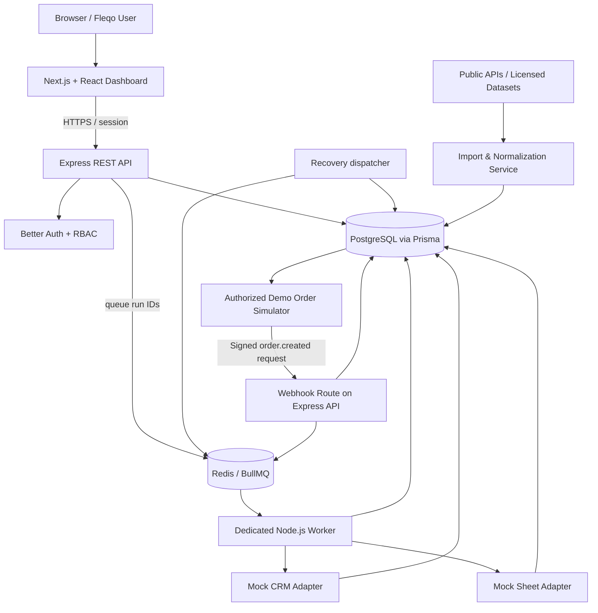
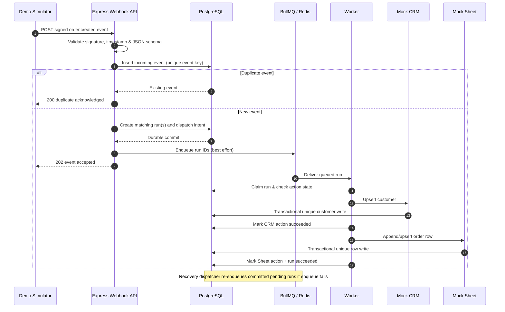

# Fleqo — System Architecture Design

**Phase:** 00 · Step 02  
**Version:** 0.1 (MVP architecture)  
**Status:** Proposed implementation baseline  
**Source of truth:** `docs/requirements.md`  
**Scope:** A multi-organization, predefined order-sync automation platform using public data and PostgreSQL-backed mock integrations.

> This document is a proposed technical design derived from the SRS. Names of internal services, headers, table additions, and folder locations are implementation decisions, not already-implemented features.

## 1. Architectural goals

Fleqo must:

1. Offer a Next.js dashboard where authenticated users configure and monitor automation.
2. Expose a separate Express + TypeScript API for auth-aware CRUD operations and signed webhook ingestion.
3. Store relational business state, imported demo data, and execution history in PostgreSQL through Prisma.
4. Use a separate Redis/BullMQ worker for automation, so the API does not wait for long-running integrations.
5. Prevent cross-organization access and duplicate downstream writes.
6. Recover persisted events if Redis or the worker is temporarily unavailable.
7. Operate initially with public datasets/APIs and PostgreSQL-backed mock CRM/Sheet destinations.

## 2. Component architecture



**Notes:**
- `Mock CRM` and `Mock Sheet` are logical adapter modules, not separate hosted providers in the MVP; they write to Fleqo's PostgreSQL tables.
- Public data imports run on the server. Data sources do not have to provide genuine order webhooks.
- Redis is a transport/retry system; PostgreSQL stores authoritative event, workflow, and execution state.
- The recovery dispatcher may run periodically in the worker process in the MVP, not necessarily as a standalone service.

## 3. Responsibilities by service

| Component | Responsibility | Must NOT do |
| --- | --- | --- |
| Next.js web | Auth screens, dashboards, workflow forms, API data display | Hold integration secrets or execute automations |
| Express API | Validate HTTP, check session + organization access, CRUD, import control, signed webhook ingestion | Run long worker jobs in the request cycle |
| Better Auth | User, account, session, verification and identity management | Replace business-specific organization permission checks |
| PostgreSQL + Prisma | Durable records, constraints, transactional mock destination writes | Serve as a Redis queue replacement |
| Redis + BullMQ | Job dispatch, backoff, worker delivery | Be the only source of truth for deduplication |
| Worker | Match workflow runs, map fields, execute actions in order, persist results | Trust user-controlled target URLs or bypass org checks |
| Public data importer | Fetch/import allowed data, validate, normalize, mark synthetic records | Treat third-party demo POST responses as persistent writes |

## 4. Browser → API communication

1. User authenticates using Better Auth endpoints mounted on Express.
2. Browser maintains secure session cookies according to the deployment origin strategy.
3. Next.js pages/components call the Express API using TanStack Query where client-side fetching is appropriate.
4. Express resolves the authenticated user, verifies their membership in the selected organization, and authorizes the requested operation.
5. The API queries Prisma with both `organizationId` and resource IDs, never only with a user-supplied resource ID.
6. Responses are JSON with consistent validation and error formats. React renders loading, empty, success, and error states.

**Production origin preference:** `app.fleqo.example` for web and `api.fleqo.example` for API (same registrable domain) or a same-origin `/api` proxy. Configure Better Auth trusted origins, cookies, CSRF protection and CORS based on the chosen deployment. Never solve cookie problems by using wildcard credentials CORS.

## 5. Webhook → action sequence



The example above describes the success case. The retry and failure path is defined below.

## 6. Webhook contract and trust boundary

**MVP public route:** `POST /api/webhooks/mock-store` (matching the SRS).

**Proposed demo-specific headers:**

- `X-Fleqo-Connection-Id`: public connection identifier used to look up the organization's configured mock store.
- `X-Fleqo-Timestamp`: Unix timestamp of the request in seconds.
- `X-Fleqo-Signature`: hex-encoded HMAC-SHA256 signature of `<timestamp>.<raw_body>` with that connection's server-side secret.

**Verification order:**

1. Resolve the connection ID to a stored, active connection. A public ID identifies a connection; it does not authorize it.
2. Read the raw request bytes before any JSON parser changes them.
3. Reject requests outside a short replay window (initial design: 5 minutes).
4. Compute the HMAC on the exact raw body and compare in constant time.
5. Parse JSON and validate the event schema and type (`order.created`).
6. Under a database unique constraint, persist `(organizationId, provider, externalEventId)` and create dispatch intent.
7. Return success only after persistence commits. Queue submission may be retried by the dispatcher.

**Route ordering:** Place Better Auth's Express handler before general `express.json()`; mount the webhook route's raw body parser before the general JSON parser as well. Other normal API routes can use JSON parsing.

## 7. Durable dispatch and idempotency

Three unique business keys are required:

- Incoming event: `(organizationId, provider, externalEventId)`.
- Workflow run: `(workflowId, incomingEventId)`.
- Action execution: `(workflowRunId, workflowActionId)` with durable action status; downstream write idempotency is separate.

**Mock destination idempotency:**

- `MockCustomer`: unique `(organizationId, provider, customerExternalId)`; use an upsert.
- `MockSheetRow`: unique `(organizationId, workflowActionId, orderExternalId)`; use an upsert/insert-on-conflict rather than unconditional append.
- Wrap local destination mutation and the action's success-state update in one PostgreSQL transaction so a worker crash does not generate a second logical effect.
- Replayed events must reuse the existing event/run records and must skip already-succeeded actions.

**Dispatch recovery:** The API commits an `EventDispatch` / outbox record in the same transaction as the incoming event and matching workflow runs. A dispatcher reads pending records and enqueues run IDs, then marks dispatch completed. If Redis is down, the outbox stays pending and the dispatcher retries. Queue job IDs are useful but are **not** the primary deduplication mechanism.

## 8. Failure management

- Action statuses: `queued`, `running`, `succeeded`, `failed`, `retrying`.
- Retry transient failures (timeouts, upstream 429/5xx) with bounded exponential backoff.
- Do not retry permanent errors (invalid credentials/schema, unauthorized access) automatically.
- Persist sanitized error message, attempt count, timestamps and action ID.
- If attempts are exhausted, mark run failed and write a dead-letter record (or equivalent persistent failure state) for investigation.
- Manual retry must be authorized and continue only incomplete actions.
- Treat network/API side effects as at-least-once unless the provider supports idempotency tokens. For real third-party integrations, add provider-specific idempotency/reconciliation later.

## 9. Data model summary

See **[`database-erd.md`](./database-erd.md)** for the relational ER diagram, model-by-model field suggestions, indexes, and organization boundaries.

Main groups:

- Auth: `User`, `Session`, `Account`, `Verification` (Better Auth-managed schema).
- Multi-tenancy: `Organization`, `OrganizationMember`.
- Configuration: `IntegrationConnection`, `Workflow`, `WorkflowTrigger`, `WorkflowAction`.
- Events: `IncomingEvent`, `EventDispatch` (proposed reliability addition).
- Runs: `WorkflowRun`, `ActionRun`, `DeadLetterEvent` (for exhausted failures).
- Demo destinations: `MockCustomer`, `MockSheetRow`.
- Other: `ImportedRecord`, `AuditLog`.

## 10. API surface (draft contract, subject to Phase 03/06 refinements)

| Method | Route | Access |
| --- | --- | --- |
| GET | `/api/health` | Public |
| ALL | `/api/auth/*` | Better Auth |
| POST | `/api/organizations` | Signed-in user |
| GET / POST | `/api/connections` | Member / Admin+ as configured |
| GET / POST | `/api/workflows` | Member / Admin+ as configured |
| GET / PATCH | `/api/workflows/:id` | Organization-scoped |
| POST | `/api/demo/import` | Admin/Owner |
| POST | `/api/demo/simulate-order` | Authorized member |
| POST | `/api/webhooks/mock-store` | Valid signed mock-store connection |
| GET | `/api/executions` | Organization-scoped |
| GET | `/api/executions/:id` | Organization-scoped |
| POST | `/api/executions/:id/retry` | Admin/Owner initially |
| GET | `/api/dashboard/summary` | Organization-scoped |

Organization context may be selected by a trusted UI header/path parameter, but membership must be verified server-side on every request. The webhook establishes tenant context from its verified connection, not from an unverified organization ID inside its JSON body.

## 11. Suggested repository structure

```text
fleqo/
├── apps/
│   ├── web/                     # Next.js app router + UI
│   │   └── src/{app,components,features,lib}
│   ├── api/                     # Express REST API
│   │   └── src/
│   │       ├── modules/{auth,organizations,connections,workflows,events,executions,demo,dashboard}
│   │       ├── middleware/
│   │       ├── lib/
│   │       └── server.ts
│   └── worker/                  # Separate long-lived BullMQ consumer
│       └── src/{queues,processors,actions,recovery}
├── packages/
│   ├── db/                      # Prisma schema, migrations, shared Prisma client
│   │   ├── prisma/
│   │   └── src/
│   └── contracts/               # Shared TypeScript types / Zod schemas
│       └── src/
├── docs/
│   ├── requirements.md
│   ├── architecture.md
│   └── database-erd.md
├── docker-compose.yml
├── .env.example
├── package.json                # npm workspaces
└── README.md
```

This is a *target structure*, not files already generated by Step 02. We will create source directories in Phase 01.

## 12. Data flow and provenance

- Fetch products/users/carts from DummyJSON or Fake Store API, or import permitted Olist CSV files.
- Validate using Zod and transform into Fleqo's normalized demo records.
- Mark imported vs synthesized records and retain data source attribution metadata.
- Generate a synthetic `order.created` event with a deterministic external order/event ID.
- Sign that event using a configured mock connection secret and send it to Fleqo's webhook receiver.
- Observe real, persisted CRM/Sheet results and execution logs.
- Never treat public test endpoints as actual customer CRMs or assume they persist POST requests.

## 13. Local and production deployment split

| Part | Local | Production target |
| --- | --- | --- |
| Frontend | Next.js dev server (`:3000`) | Vercel |
| API | Express dev server (`:4000`) | Railway or equivalent long-running host |
| Worker/dispatcher | Node.js worker process | Separate Railway worker service |
| PostgreSQL | Docker | Managed PostgreSQL (e.g. Neon) |
| Redis | Docker | Managed Redis compatible with BullMQ |

Production migrations run as controlled release operations. Worker and API share the database and queue credentials but run independently. Set resource limits and budgets; this design does not claim free production hosting.

## 14. Decision log

| Decision | Why | Consequence |
| --- | --- | --- |
| Express, not NestJS | Chosen by project owner for hands-on architecture learning | We implement modular layers ourselves |
| PostgreSQL + Prisma | Relational workflow data and integrity constraints | Prisma v7 PostgreSQL driver adapter and config required |
| Better Auth in Express | One backend authentication boundary | Route/body parser order matters |
| Dedicated BullMQ worker | Avoid running actions inside API requests | Deploy worker separately |
| PostgreSQL-backed mock destinations | Public demo APIs don't guarantee persistence | End-to-end effects can be tested reliably |
| Database idempotency + outbox | Safe duplicates and queue failure recovery | A little additional implementation complexity |
| Form-based workflows only | Keep solo-developer MVP tractable | Visual canvas deferred |

## 15. Step 02 review checklist

- [ ] I can explain what runs in `web`, `api`, `worker`, and `packages`.
- [ ] I understand why PostgreSQL is authoritative and Redis is the queue.
- [ ] I can trace one signed order event from simulator to CRM and Sheet.
- [ ] I understand why `organizationId` requires backend authorization.
- [ ] I understand why event/run/action uniqueness must be enforced in PostgreSQL.
- [ ] I reviewed `database-erd.md` and the deployment diagram.

**Next:** Phase 01 — initialize npm workspaces, Next.js, Express, Docker PostgreSQL/Redis, and basic health endpoints. No application source code needs to be written during Step 02.
