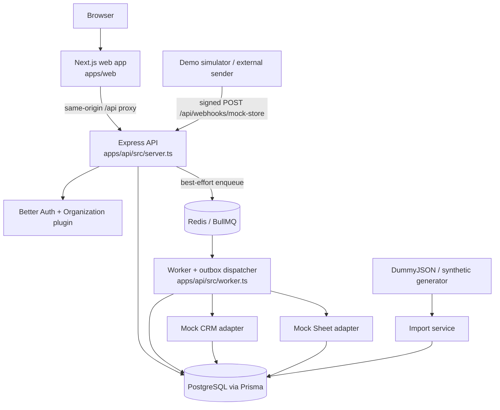
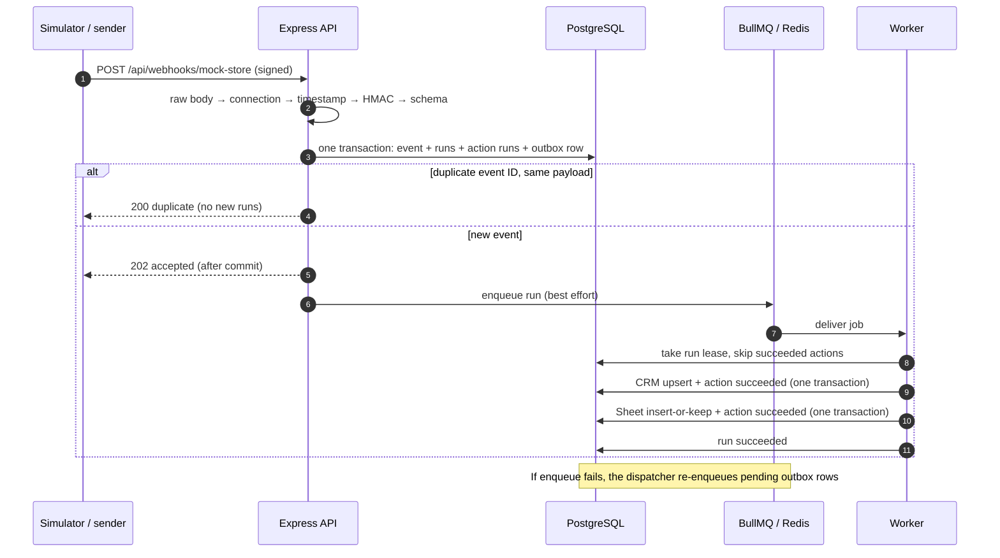

# Fleqo — Architecture

Fleqo is a multi-tenant order-sync automation platform. A signed `order.created` webhook from a store becomes a workflow run that upserts the customer into a CRM and appends the order to a spreadsheet, exactly once per order, with retries, a dead-letter queue and a per-attempt execution log. The store, CRM and spreadsheet are PostgreSQL-backed mock integrations, so every effect is real, inspectable and testable.

Related: [database-erd.md](./database-erd.md) · [api-spec.yaml](./api-spec.yaml) · [security.md](./security.md) · [authentication.md](./authentication.md) · [frontend.md](./frontend.md) · [testing.md](./testing.md) · [deployment.md](./deployment.md)

## 1. Components



| Component | Responsibility | Never does |
| --- | --- | --- |
| Next.js web | Landing page, auth screens, dashboard, workflow forms, execution views | Hold integration secrets or execute automations |
| Express API | HTTP validation, sessions, organization RBAC, CRUD, demo import, signed webhook ingestion | Run workflow actions inside a request |
| Better Auth | Users, sessions, accounts, organizations, members, invitations | Replace Fleqo's per-request membership checks |
| PostgreSQL + Prisma | Source of truth: events, runs, action state, logs, outbox, destination records | Act as the queue |
| Redis + BullMQ | Job delivery, backoff, retries | Decide idempotency (database keys do) |
| Worker | Execute runs in order, write destinations, persist results; dispatch the outbox; recover stale runs | Trust user-supplied URLs or bypass tenant checks |

The worker is a second entry point in `apps/api`, so the API and worker share one Prisma client, the engine code and one Docker image, yet run as independent processes.

## 2. Event lifecycle



1. **Verification order** (`src/modules/webhooks`): the raw bytes are read before any JSON parser; `X-Fleqo-Connection-Id` resolves an active connection (a public ID identifies, it never authorizes); `X-Fleqo-Timestamp` must be within ±300 s; `X-Fleqo-Signature` is a constant-time-compared HMAC-SHA256 of `<timestamp>.<raw body>` with the connection's decrypted secret; then Zod validates the event.
2. **Ingestion** (`ingest.service.ts`): one transaction stores the `IncomingEvent` (unique per organization + provider + event ID), a `WorkflowRun` per matching active workflow, its `ActionRun`s, an `EventDispatch` outbox row and log entries. The API answers only after the commit. A unique violation means a duplicate: the same canonical payload hash returns `200 {"status":"duplicate"}`; a different payload under the same ID returns `409`.
3. **Dispatch** (`src/engine/dispatcher.ts`): the API enqueues `run-<id>-g<generation>` immediately. If Redis is down, the outbox row stays `pending`; the worker's dispatcher claims rows with `FOR UPDATE SKIP LOCKED` and a lease, enqueues them and marks them dispatched, backing off on errors.
4. **Execution** (`src/engine/executor.ts`): the worker takes a run lease, runs actions in order and skips succeeded ones. It maps fields (`mapping.ts`, re-validated with Zod), then commits the adapter write and a conditional `ActionRun → succeeded` update in the same transaction (`src/integrations/mock-providers.ts`). Transient errors mark the action `retrying` and rethrow, so BullMQ retries with exponential backoff (`WORKFLOW_MAX_ATTEMPTS`). Permanent errors or the final attempt mark it `failed`, write a `DeadLetterEvent` and stop retries.
5. **Recovery** (`recovery.ts`): every few dispatcher passes, unfinished runs whose queue job is gone, failed or completed are re-dispatched with a new generation. Jobs BullMQ still owns (waiting, active, delayed) are left alone.
6. **Manual retry** (`POST /api/executions/:id/retry`, Admin/Owner): only incomplete actions run again, under a new dispatch generation.

## 3. Idempotency and failure handling
| Layer | Mechanism |
| --- | --- |
| Event | `UNIQUE (organizationId, provider, externalEventId)` plus a canonical (key-sorted) JSON hash |
| Run | `UNIQUE (workflowId, incomingEventId)`; lease taken by a conditional UPDATE |
| Action | `UNIQUE (workflowRunId, workflowActionId)`; success committed only `WHERE status='running' AND attempts=<n>` |
| Destination | Customer upsert key; sheet row insert-or-keep key; written in the same transaction as the action's success |
| Queue | Job IDs avoid duplicate jobs but are **not** relied on for correctness |

- Statuses: `queued`, `running`, `retrying`, `succeeded`, `failed`.
- Errors are classified as transient (retried) or permanent (dead letter); sanitized messages, attempt counts and timings are persisted per attempt in `execution_log`.
- A crash between a destination write and its status update cannot double-write: both are in one transaction, and a re-delivered job finds the action already succeeded.

## 4. Request pipeline and authorization
`src/app.ts`, in order:
1. `pino-http` (request ID, `clientIp`, redaction)
2. Helmet
3. CORS (`WEB_ORIGINS`, credentials, no wildcard)
4. `Cache-Control: no-store`
5. Health routes
6. **Better Auth** at `/api/auth/*`
7. **Webhooks** (`express.raw`, 64 KB, per-IP limit)
8. `express.json` (256 KB)
9. API rate limit
10. **Trusted-origin check** for cookie-authenticated mutations
11. Module routers
12. 404, then the error handler (`{ error: { code, message, details?, requestId } }`)

`requireOrg(permission)` (`src/middleware/auth.ts`) loads the Better Auth session, takes the tenant from the session's `activeOrganizationId` (never from request input), re-reads the membership, and checks the role against the shared permission model in `src/lib/permissions.ts`. Every query filters by resource ID **and** `organizationId`, so cross-tenant access returns 404. The webhook tenant comes only from the verified connection. Details: [security.md](./security.md), [authentication.md](./authentication.md).

## 5. Demo data and simulator
- **Import** (`src/modules/demo/import.service.ts`): DummyJSON users, products and carts (fixed URLs, Zod-validated, prices converted to integer minor units, source and licence recorded), or an offline deterministic generator. Every generated record is marked synthetic.
- **Simulator** (`simulator.service.ts`): builds `order.created` events, signs them with the tenant's secret and passes them through the **same** verification and ingestion code as external webhooks. Deterministic fault injection (`simulation.failures`) is honoured only by the mock adapters, so retries, dead letters and manual retry can be demonstrated.

## 6. Processes and deployment
| Process | Entry point | Local | Production ([deployment.md](./deployment.md)) | $0 demo ([deployment-demo.md](./deployment-demo.md)) |
| --- | --- | --- | --- | --- |
| Web | `apps/web` (Next.js) | `npm run dev:web` (:3000) | Vercel | Vercel Hobby |
| API | `apps/api/src/server.ts` | `npm run dev:api` (:4000) | Render Web Service (Docker), pre-deploy `npm run db:deploy` | Combined in one Render Free web service via `node dist/single-service.js`, which runs migrations when pending and supervises both processes |
| Worker + dispatcher | `apps/api/src/worker.ts` | `npm run dev:worker` | Render Background Worker, same image | (as above) |
| PostgreSQL | — | Docker (`compose.yaml`) | Render Postgres | Neon Free |
| Redis | — | Docker | Render Key Value (`noeviction`) | Render Key Value Free (`noeviction`) |

The browser only talks to the web origin; Next.js rewrites `/api/*` to the API, so Better Auth cookies stay first-party and CORS stays strict.

## 7. Repository layout
```
apps/
  api/                    Express API + worker (TypeScript, ESM), Dockerfile
    prisma/               schema.prisma, migrations/   (prisma.config.ts next to it)
    src/
      server.ts worker.ts single-service.ts app.ts
      config/             environment validation (Zod)
      contracts/          order.created event schema
      engine/             queue, dispatcher (outbox), executor, recovery, mapping
      integrations/       PostgreSQL-backed mock CRM / Sheet adapters
      lib/                auth (Better Auth), prisma, redis, mailer, permissions, crypto, logger
      middleware/         auth (requireOrg), origin-check, error-handler
      types/              request context typing
      modules/            organizations, connections, workflows, webhooks, executions, demo, dashboard, audit, public
      scripts/            seed.ts, smoke.ts
    test/                 Vitest + Supertest suites (incl. 100-event batch, security, recovery)
  web/                    Next.js App Router + Tailwind + shadcn/ui + TanStack Query
    src/app/              (auth) (app) docs/ invite/ onboarding/ + landing page, metadata routes
    src/components/ src/features/ src/lib/
    e2e/                  Playwright specs (app flows, landing, theme, accessibility, auth)
deploy/                   environment templates: env/ (production), demo/ (single service)
docs/                     this documentation
scripts/                  reliability-check.sh (process-level fault injection)
compose.yaml              PostgreSQL + Redis for local development
```

## 8. Design decisions
| Decision | Why | Cost |
| --- | --- | --- |
| Separate Express API; worker as a second entry point in `apps/api` | One Prisma client and shared engine; independently deployable processes | API and worker ship the same image |
| PostgreSQL is the source of truth, Redis only transports | Queue IDs cannot guarantee exactly-once side effects | Outbox table and dispatcher loop |
| Transactional outbox + `SKIP LOCKED` dispatcher | An accepted event is never lost when Redis is down | Up to `DISPATCH_POLL_MS` extra latency during outages |
| Run lease + conditional action update in the destination transaction | Duplicate jobs, crashes and retries cannot double-write | One extra conditional UPDATE per action |
| Better Auth Organization plugin | Official members/invitations/roles; no duplicate tables | Fleqo still re-checks membership per request |
| Tenant from the session's active organization | No client-supplied organization ID can grant access | Switching organizations affects all of a user's tabs |
| Same-origin `/api` proxy (Next.js rewrites) | First-party cookies without cross-site cookie settings | One extra hop through the web host |
| Canonical JSON hash for duplicates | JSONB reorders keys; re-sends must still match | Key-order-only changes count as the same event |
| Mock destinations in PostgreSQL | Public demo APIs do not persist writes; effects must be verifiable | Real providers would need their own idempotency or reconciliation |
| Form-based workflows (one trigger, two actions) | A tractable, fully tested scope | No visual canvas or branching yet |
