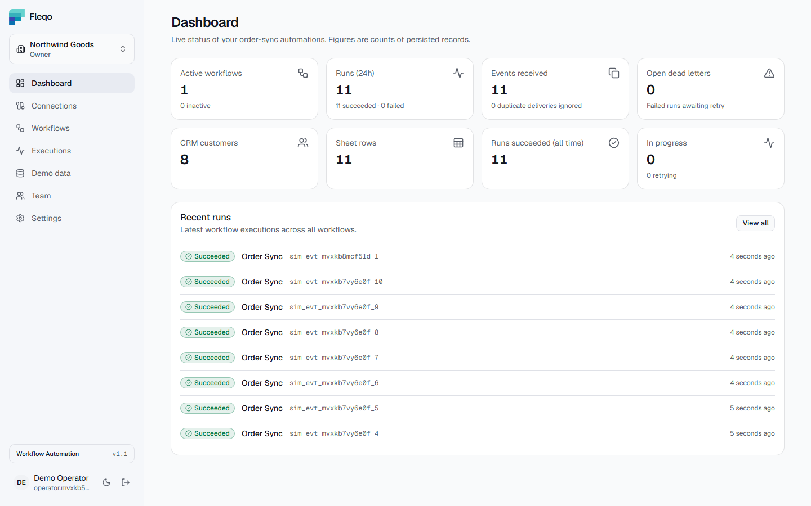
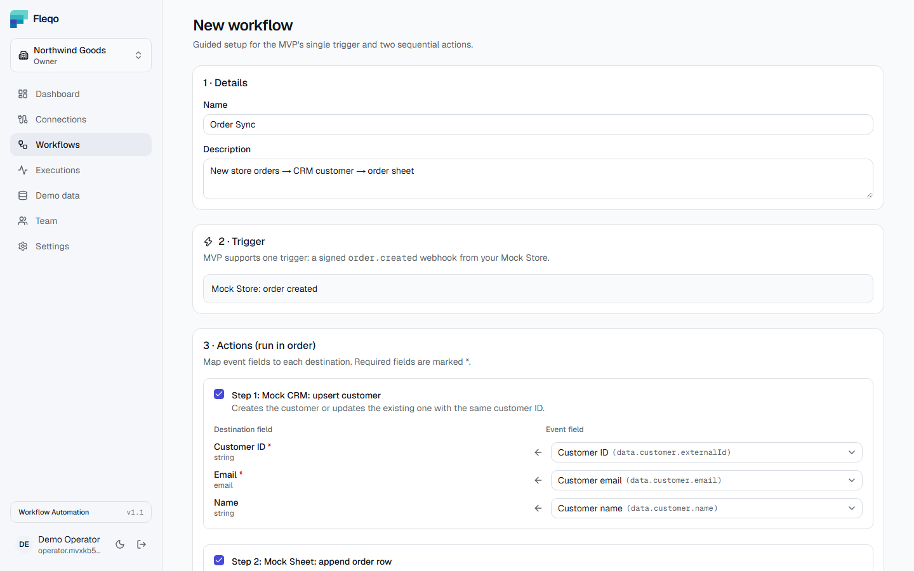
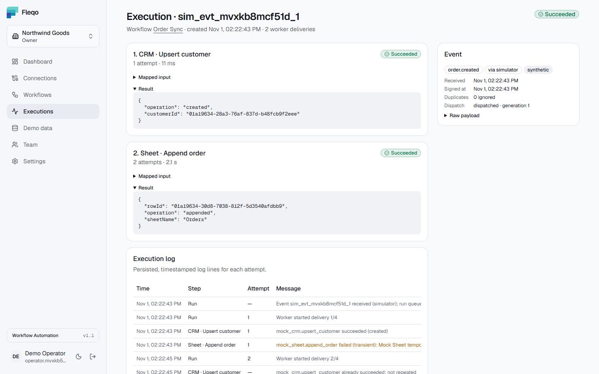
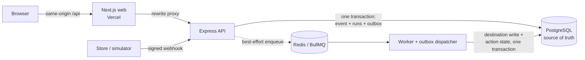

# Fleqo — Case Study

**Exactly-once workflow automation in a world of retries, crashes and duplicate deliveries.**

| | |
| --- | --- |
| **Product** | Multi-tenant workflow automation SaaS (portfolio prototype) |
| **Role** | Solo project: product scope, architecture, backend, frontend, testing and deployment |
| **Timeline** | Oct 31 – Nov 2, 2026: v1.0 MVP → v1.1 public website → live deployment |
| **Stack** | Next.js, React, TypeScript, Express, PostgreSQL, Prisma, Redis, BullMQ, Better Auth, Tailwind CSS, Docker, GitHub Actions |
| **Links** | [Live demo](https://fleqo-web.vercel.app) · [Repository](https://github.com/shariardipto/Fleqo) · [README](../README.md) |

<picture>
  <source media="(prefers-color-scheme: dark)" srcset="../apps/web/public/screens/dashboard-dark.png">
  
</picture>

## Summary

Small online stores often copy every new order by hand into a CRM and a spreadsheet. Fleqo automates that path: a signed `order.created` webhook becomes a workflow run that upserts the customer into a CRM and appends the order to a sheet.

Calling two APIs is the easy part. The real requirement is **trust**: each order must land exactly once, even when the store re-sends a webhook, a worker crashes halfway, or Redis goes down. And when something does fail, a person must be able to see what happened and retry safely. Fleqo was designed around those failure cases first.

**Outcomes**
- **Exactly-once side effects, proven by tests.** A 100-event batch with 25 duplicates, 5 forgeries and 10 injected failures ends with 100 runs, 30 CRM customers, 100 sheet rows and 0 dead letters. Eight process-level scenarios (worker killed, Redis and PostgreSQL restarted) lose no runs and repeat no completed action.
- **Verified on every push.** CI runs 74 API integration tests and 26 browser tests, including axe WCAG AA checks in light and dark themes, plus crash-recovery scenarios, a smoke test and the Docker build.
- **Live for $0.** Vercel, Render Free, Neon Free and Render Key Value Free host the demo, with the API and worker sharing one 0.1-CPU container through a purpose-built process supervisor.

## 1. The problem

Copying orders between a store, a CRM and a spreadsheet is slow and error-prone:
- Orders get entered twice or not at all.
- Customer records drift apart between systems.
- Nobody notices when a transfer fails.

Automation fixes the speed, but introduces a subtler problem. Webhooks are delivered **at least once**, job queues retry, and processes crash. A naive automation can create duplicate customers or rows, or silently drop an order. For an operator, an automation they cannot trust is worse than doing the work by hand.

## 2. Goals and constraints

| Goal | What it means in practice |
| --- | --- |
| **Correct** | One CRM upsert and one sheet row per order, no matter how often the event is delivered or retried |
| **Durable** | An event the API accepted is never lost, even if the queue is down |
| **Observable** | Every attempt, error and retry is recorded and visible per action |
| **Secure and multi-tenant** | Signed webhooks; organizations isolated from each other; roles enforced on the server |
| **Verifiable** | Every claim above is backed by an automated test, not a description |

**Constraints**
- **No paid APIs and no real customer data.** Public demo APIs don't persist writes, so their effects can't be verified. The store, CRM and sheet are therefore **PostgreSQL-backed mock integrations**. Every side effect is real, inspectable and testable, which makes exactly-once something tests can prove rather than something the docs claim. Sample data comes from [DummyJSON](https://dummyjson.com/docs) or an offline generator and is labelled synthetic.
- **A $0 hosting budget** for the public demo.
- **Solo scope.** One trigger (`order.created`) and two sequential actions, built properly, rather than a broad workflow builder built shallowly.

**Non-goals:** a visual workflow canvas, real Shopify/HubSpot/Google Sheets connectors, billing, and high-volume scale guarantees.

## 3. The product

Fleqo serves two kinds of users: **Owners and Admins**, who configure automations and fix failures, and **Members**, who monitor them.

1. **Create an organization** and invite teammates with an invite link and a role.
2. **Connect** the Mock Store, Mock CRM and Mock Sheet. The store's webhook signing secret is encrypted at rest and shown once.
3. **Build the workflow** with a guided form: `order.created` → upsert customer → append order, with type-checked field mapping.
4. **Send events** from the built-in simulator. It can inject failures or re-send duplicates, so the reliability behaviour is visible in the UI.
5. **Monitor** the dashboard and execution history: each run shows every action's input, output, attempts, errors and a timestamped log. Failed runs can be retried.

<table>
  <tr>
    <td width="50%">
      <picture>
        <source media="(prefers-color-scheme: dark)" srcset="../apps/web/public/screens/workflows-dark.png">
        
      </picture>
      
Guided workflow builder

    </td>
    <td width="50%">
      <picture>
        <source media="(prefers-color-scheme: dark)" srcset="../apps/web/public/screens/executions-dark.png">
        
      </picture>
      
Execution detail: the Sheet action needed 2 attempts; the CRM action was not repeated

    </td>
  </tr>
</table>

A public landing page includes an **interactive demo that runs entirely in the browser**. It signs a sample event with a real HMAC (WebCrypto), walks it through the pipeline, flags a re-sent duplicate, and simulates an outage whose retry skips completed work. Visitors understand the product before they create an account.

## 4. Architecture

| Decision | Reason |
| --- | --- |
| Express API plus a **separate worker** process, sharing one codebase and Docker image | Webhook ingestion stays fast and never runs actions inside a request; the worker scales independently |
| **PostgreSQL is the source of truth; Redis only transports jobs** | A queue cannot guarantee exactly-once side effects; database constraints and transactions can |
| **Same-origin proxy:** the browser only talks to the web app, which forwards `/api/*` | Session cookies stay first-party and CORS stays strict, with no cross-site cookie settings |
| **Better Auth with the Organization plugin** | Proven users, sessions, organizations and invitations, with Fleqo adding its own per-request authorization on top |
| **Mock destinations in PostgreSQL** | Destination writes can share a transaction with the action's state, which is what makes exactly-once provable |

Details: [architecture.md](./architecture.md) · [database-erd.md](./database-erd.md) (21 tables) · [api-spec.yaml](./api-spec.yaml) (41 documented operations)

## 5. Engineering deep dives

### 5.1 Exactly-once side effects from an at-least-once queue

**Problem.** BullMQ, like every practical queue, delivers jobs *at least once*. Suppose a worker writes the customer to the CRM and then crashes before recording success. The retry writes the customer again. Queue job IDs only prevent duplicate *enqueueing*, not duplicate *execution*.

**Solution.** Idempotency lives in the database, in four layers:

| Layer | Mechanism |
| --- | --- |
| Event | `UNIQUE (organization, provider, external event ID)` |
| Run | `UNIQUE (workflow, event)`, plus a **lease** taken with a conditional `UPDATE` so only one worker executes a run at a time |
| Action | `UNIQUE (run, workflow action)`; success is committed only `WHERE status = 'running' AND attempts = <n>` |
| Destination | Customer upsert key and sheet insert-or-keep key, written **in the same transaction** as the action's success |

Because the destination write and the "action succeeded" update commit together, a crash rolls back both or neither. A re-delivered job finds the action already succeeded and skips it.

**Proof.** In the reliability script the worker is killed with `SIGKILL` while the Sheet action waits to retry. After the restart, the CRM action shows exactly 1 attempt and the Sheet action finishes on its 4th. Separately, duplicate queue jobs for the same run commit exactly once (`worker.test.ts`).

### 5.2 Never losing an accepted event

**Problem.** The obvious design commits the event to PostgreSQL and then enqueues a job in Redis. If Redis is unavailable between those two steps, the store receives `202 Accepted`, but the order is never processed: a classic dual-write failure.

**Solution.** A **transactional outbox.**
1. The event, its runs, their actions and an `event_dispatch` row are written in **one transaction**, and the API answers only after the commit.
2. The API then enqueues on a best-effort basis.
3. The worker's dispatcher claims any rows still pending using `FOR UPDATE SKIP LOCKED` and a lease, so several workers can run it safely, and enqueues them.
4. A recovery sweep re-dispatches unfinished runs whose queue jobs disappeared, under a new dispatch generation. It leaves alone the jobs BullMQ still owns.

**Proof.** With Redis stopped, the API still accepted events, `/api/ready` reported 503, and the outbox held 5 pending rows; when Redis returned, all were dispatched and succeeded. In the free-tier emulation, wiping the queue mid-retry still ended with 52 succeeded runs and exactly 52 sheet rows.

### 5.3 Trusting a webhook

- **Raw body first.** The signature covers the exact bytes the sender signed, so the webhook route reads the raw body *before* any JSON parser runs.
- **Identity is not authority.** `X-Fleqo-Connection-Id` only selects the connection. The request is authorized by a constant-time HMAC-SHA256 of `<timestamp>.<raw body>` with that connection's decrypted secret.
- **Replay window.** Timestamps outside ±300 seconds are rejected.
- **Tenant from the verified connection only.** Any organization ID inside the body is ignored.
- **Duplicates that survive reformatting.** PostgreSQL's JSONB reorders keys, so duplicate detection hashes a *canonical* (key-sorted) JSON form. Re-sending the same event, even with keys reordered, returns `200 duplicate` with no new run; the same event ID with a different payload returns `409`.

**Proof.** 10 webhook tests cover forged and garbage signatures, altered bodies, stale and future timestamps, schema errors with field paths, oversized bodies and cross-tenant bodies. In the batch, 5 forged deliveries returned 401 and 5 reformatted duplicates were acknowledged without new runs.

### 5.4 Multi-tenancy and a flaw found in review

Every protected request takes the tenant from the session's **active organization**, never from request input. It re-reads the membership and role, and queries by resource ID **and** organization ID, so another tenant's data returns 404 rather than 403. One permission model serves both Fleqo's routes and Better Auth's organization endpoints.

**The flaw.** A security review of the invitation flow found a cross-feature problem. Email/password sign-ups are unverified unless an email provider is configured, but invitations could be listed by email address. Anyone who registered an invitee's address before they did could see the invitation and accept it, joining the organization with the invited role.

**The fix.** Invitations now work only through an **invite link** carrying a random 32-character ID that the inviter shares directly. Listing invitations by email is disabled, including Better Auth's built-in endpoint, and any other account gets 403. A regression test in the security suite locks this in.

The same thinking shaped the optional OAuth sign-in. A Google or GitHub identity is **never linked into an unverified local account**. That blocks *account pre-hijacking*, where an attacker registers a victim's address with a password and waits for the victim to sign in with Google.

### 5.5 Making failure visible and recoverable

- Errors are classified as **transient** (retried with exponential backoff, 4 attempts by default) or **permanent** (written to a dead-letter record immediately).
- Every attempt is written to an execution log with timing, error kind and a sanitized message, shown per action in the UI.
- **Manual retry** (Owner/Admin) re-runs only incomplete actions under a new dispatch generation, so completed work is never repeated.
- The dashboard counts open dead letters and in-progress runs, and every number on it is a count of persisted records.

### 5.6 Frontend quality

- Every data view has three designed states (loading skeleton, error with retry, and an empty state that explains the next step) and refreshes live where it matters.
- Light, dark and system themes apply before first paint, with no flash, and are built on semantic design tokens. axe-core finds **0 serious or critical WCAG AA violations on 14 pages in both themes**.
- E2E tests run against the production build **with the production Content Security Policy**, and a shared fixture fails any test on a console error or CSP violation.

## 6. Verification strategy

The project rule was **"prove it, don't claim it"**: every reliability or security statement needed a test that would fail if it stopped being true.

| Layer | What it covers |
| --- | --- |
| API integration (Vitest + Supertest, real PostgreSQL and Redis) | 74 tests: tenancy and RBAC, webhook security, idempotency, retries, recovery decisions, auth and email flows |
| 100-event batch | Mixed load through the real ingestion and worker path, with exact final counts asserted |
| Browser E2E (Playwright) | 26 tests: the full operator loop, roles, invite links, password reset, themes, landing page, accessibility |
| Process-level reliability | The compiled API and worker against throwaway containers: worker killed, Redis and PostgreSQL restarted, API restarted, duplicates afterwards |
| Smoke | 13 black-box checks, run against any deployment after release |

CI runs all of it on every push, together with a dependency audit, migrations, a schema-drift guard and the Docker build. Tests use an isolated `*_test` database and refuse to run against anything else.

**Clean checkouts found real bugs** that the developer machine hid:
- **Typecheck failed in CI.** It relied on route types that Next.js generates only during a build, which existed locally but not in a fresh clone. GitHub Actions surfaced it and a clean clone reproduced it; the fix runs `next typegen` before `tsc`.
- **Sign-in redirected to the wrong page.** A `callbackURL` passed on sign-in made Better Auth send every successful sign-in to the email-verification page. A clean-clone run of the CI steps caught it before it reached GitHub. The fix restored the normal destination, and a browser test now covers it.

## 7. Shipping on a $0 budget

The production topology runs the API and worker as separate services with a paid database and persistent Redis ([deployment.md](./deployment.md)). The public demo had to cost nothing, and the free tiers impose real limits:
- Render has **no free background worker**, and its free tier has **no pre-deploy step** for migrations.
- Free instances get **0.1 CPU and 512 MB** and sleep after 15 minutes without traffic.
- Free Key Value (Redis) **does not persist** data.
- Neon's free PostgreSQL **scales to zero** when idle.

**Solution: one container, two supervised processes.** A small supervisor (`single-service.ts`) runs the unchanged API and worker as child processes:
- **Migrations:** it compares the image's migrations with the database and runs them only when something is pending. The check takes 0.8 s instead of about 20 s for the Prisma CLI, which matters on every wake-up.
- **Database wake-up:** it retries migrations 5 times to cover Neon resuming from sleep. If that still fails, it refuses traffic, so the deploy fails and the previous version keeps serving.
- **Start order:** it starts the API first, then the worker at lower CPU priority, so visitors' requests win the CPU.
- **Crash handling:** it restarts a crashed child with backoff. After 6 crashes in 5 minutes it exits, so the platform restarts everything.
- **Shutdown:** it forwards `SIGTERM` to both processes with a grace period, so jobs in progress can finish.

**Emulating the platform locally found problems before users did.** The production image was first run the way Render runs it (same build context, non-root user, no internet during migrations), then under the free tier's limits (`--cpus 0.1 --memory 512m`, a TLS PostgreSQL, a 25 MB non-persistent Valkey):

| Found | Fix |
| --- | --- |
| **Sign-up failed** on 0.1 CPU: password hashing plus queries took 7.8 s, beyond Prisma's 5 s transaction limit | Configurable transaction timeouts: production keeps the defaults, the demo uses 30 s |
| `npx prisma migrate deploy`, run from the wrong directory, **silently downloaded and ran a Prisma 8 release candidate** from npm | The documented release command became `npm run db:deploy`, which uses the CLI bundled in the image |
| A Key Value instance left on its default eviction policy could silently drop queued jobs | The setup guides require `noeviction`, and the troubleshooting guide covers the worker's warning |

| Measured under free-tier limits | Result |
| --- | --- |
| Wake-up to healthy, nothing to migrate | 19.8 s, plus the platform's own spin-up |
| Memory, idle → peak | 145 → 190 MiB of 512 MiB |
| 40 orders, 20 with an injected failure | All 40 succeeded in 7 s; only failed actions retried |
| Queue wiped while runs waited to retry | All recovered from PostgreSQL in 161 s; no duplicate rows |
| Worker or API killed | Restarted automatically; work continued |
| `SIGTERM` with runs in flight | Clean stop in 0.6 s; interrupted runs completed after restart |

One behaviour only appeared live. While a sleeping backend wakes, Render answers the first requests with an immediate 502 rather than holding them. The README and the demo guide now tell visitors to expect up to 1–2 minutes on first sign-in.

Along the way the production Docker image shrank from 1.34 GB to 725 MB.

## 8. Results

| Measure | Result |
| --- | --- |
| API integration tests | 74 / 74 passing in CI |
| Browser tests | 23 passing; 3 OAuth tests skip without provider credentials |
| 100-event batch | 100 runs succeeded, 30 CRM customers, 100 sheet rows, 215 action attempts (200 + 15 injected retries), 0 dead letters |
| Duplicates and forgeries in the batch | 25 / 25 acknowledged without new runs; 5 / 5 forged rejected |
| Reliability scenarios | 8 / 8 passing: no lost runs, no duplicate rows, no completed action repeated |
| Accessibility | 0 serious or critical axe violations on 14 pages in both themes |
| Smoke test against a deployment | 13 / 13 |
| Hosting cost of the live demo | $0 |

These are functional and failure-recovery results. No load testing was done, so no throughput claims are made.

## 9. Trade-offs and limitations

| Trade-off | Consequence |
| --- | --- |
| Mock destinations instead of real CRM and sheet APIs | Exactly-once is provable end to end; a real provider would need its own idempotency keys or reconciliation |
| Outbox and dispatcher loop | Up to one poll interval of extra latency during a Redis outage |
| Form-based workflow with one trigger and two actions | A narrow scope, fully tested; no branching or visual canvas |
| Free-tier demo | It sleeps when idle, and background processing pauses with it |
| In-memory rate limits | Correct for one API instance; several replicas would need a Redis-backed store |

Social sign-in and email verification are implemented and tested offline, but not enabled on the live demo. Execution and audit logs have no retention job yet.

## 10. Lessons learned

- **Design the failure paths first.** Duplicates, crashes and outages shaped the schema, the transaction boundaries and the UI. Those decisions are hard to retrofit once the happy path is built.
- **Put correctness where it can be enforced.** Unique constraints and transactions guarantee what queue settings can only encourage.
- **Emulate the target platform.** Running the image as the host runs it, under the same CPU and memory limits, found a failed sign-up and a silent CLI download that no local or CI run showed.
- **Test from a clean checkout.** Generated files and leftover state on a developer machine hid a CI failure and a sign-in bug.
- **Review flows, not just functions.** The invitation flaw only existed in the combination of two features that were each fine on their own.
- **Keep the UI truthful.** Labelling mocks and synthetic data, and showing only persisted counts, makes a demo more credible, not less.

## 11. What's next

- Real connectors (Shopify, Google Sheets, HubSpot) using provider idempotency keys and reconciliation.
- More triggers and actions, conditional steps, and eventually a visual builder.
- Redis-backed rate limits for running several API replicas.
- A retention job for execution and audit logs.
- A nonce-based Content Security Policy, and metrics and alerting for dead letters and queue latency.

---

**Explore further:** [Live demo](https://fleqo-web.vercel.app) · [Architecture](./architecture.md) · [Security](./security.md) · [Testing](./testing.md) · [Free-tier deployment](./deployment-demo.md) · [Production deployment](./deployment.md)
