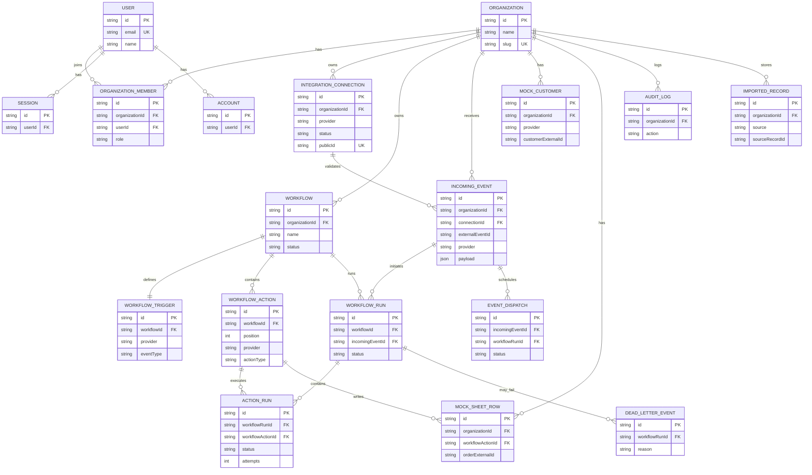

# Fleqo — Database ERD and Data Model Plan

**Phase:** 00 · Step 02  
**Version:** 0.1 (proposed schema; not yet migrated)  
**Database:** PostgreSQL  
**ORM:** Prisma 7

This design expands the data-model section of `requirements.md`. Tables will be implemented and validated during Phase 02, not during Phase 00.

## 1. Entity-relationship diagram

`Verification` (Better Auth) is also required but is omitted from the diagram for readability. The exact Better Auth fields must be generated/verified against its adapter schema in Phase 03. Mermaid entities above list **key fields only**, not full production column definitions.

## 2. Schema groups

| Group | Entities | Purpose |
| --- | --- | --- |
| Identity | User, Session, Account, Verification | Better Auth-managed authentication |
| Organizations | Organization, OrganizationMember | Tenant boundaries and roles |
| Configuration | IntegrationConnection, Workflow, WorkflowTrigger, WorkflowAction | User automation rules |
| Ingestion | IncomingEvent, EventDispatch | Durable event and dispatch |
| Execution | WorkflowRun, ActionRun, DeadLetterEvent | Action history, failure visibility |
| Mock destinations | MockCustomer, MockSheetRow | Real persistent effects of demo actions |
| Demo/import | ImportedRecord | Normalized external/sample data provenance |
| Audit | AuditLog | Who changed what and when |

`EventDispatch` and `ImportedRecord` are architecture additions beyond the initial SRS table list: they implement its durable recovery and public-data import requirements. `RetryJob` does not have to be a separate initial table because BullMQ handles job scheduling and `ActionRun` captures durable attempts; this is an implementation choice.

## 3. Database constraints and indexes

| Entity | Key constraint/index | Reason |
| --- | --- | --- |
| OrganizationMember | `UNIQUE (organizationId, userId)` | One membership per user per org |
| IntegrationConnection | `UNIQUE (publicId)` | Identify a signed mock connection |
| WorkflowTrigger | `UNIQUE (workflowId)` | Exactly one trigger in MVP |
| WorkflowAction | `UNIQUE (workflowId, position)` | Stable, ordered actions |
| IncomingEvent | `UNIQUE (organizationId, provider, externalEventId)` | Event idempotency |
| WorkflowRun | `UNIQUE (workflowId, incomingEventId)` | One run per workflow/event |
| ActionRun | `UNIQUE (workflowRunId, workflowActionId)` | One logical action state per run |
| EventDispatch | `UNIQUE (workflowRunId)` | Prevent duplicated dispatch intent |
| MockCustomer | `UNIQUE (organizationId, provider, customerExternalId)` | Safe CRM upsert |
| MockSheetRow | `UNIQUE (organizationId, workflowActionId, orderExternalId)` | Safe order row insert/upsert |
| ImportedRecord | `UNIQUE (organizationId, source, sourceRecordId)` | Repeatable import |
| WorkflowRun | `INDEX (status, createdAt)` and `INDEX (workflowId, createdAt)` | Monitoring queries |
| IncomingEvent | `INDEX (organizationId, createdAt)` | Event history |
| ActionRun | `INDEX (status, updatedAt)` | Retry and monitoring |

Fields such as `createdAt`, `updatedAt`, error metadata, source attribution, original JSON, and organization-scoping foreign keys are expected in the actual Prisma models.

## 4. Example tenant access rule

A signed-in user cannot access a workflow by ID alone. The API first verifies that the user is an active member of the selected organization; then it looks up `Workflow` using both `id` and `organizationId`. The worker resolves organization scope from persisted, already-validated event and run references, never from the job payload as an authority.

## 5. Money and event data

- Preserve `order.totalMinor` as integer minor currency units with `order.currency`.
- Preserve the original received webhook JSON as a `JSONB`-compatible Prisma `Json` field for authorized debugging.
- Preserve normalized fields used by CRM/Sheet actions separately from raw payload.
- Use synthetic customer contact details by default; avoid embedding real personal data in public demo seeds.
- Include timestamps for ingestion, start, completion, retry attempts and state transitions.

## 6. What will be implemented when?

- **Phase 02:** Identity-compatible schema foundations, Organization, Workflow, Trigger, Action, Connection, Event, Run, ActionRun and initial constraints.
- **Phase 03:** Better Auth actual models and organization/role access.
- **Phase 04–05:** ImportedRecord, MockCustomer and MockSheetRow.
- **Phase 07–09:** EventDispatch, dead-letter records, transaction-safe action writes, recovery indexes.

This staging is a task plan. All design constraints should be captured before corresponding features go live.

## 7. Review questions

1. Why is `organizationId` repeated across business-owned entities?
2. Why does `IncomingEvent` need a unique key separate from `WorkflowRun`?
3. Why does a `MockSheetRow` need a unique external order ID instead of blind append?
4. What happens if PostgreSQL commit succeeds but Redis enqueue fails?
5. Which entities are created by Better Auth rather than manually designed?

**Next:** Phase 01 setup, followed by Phase 02 Prisma schema and migrations.
